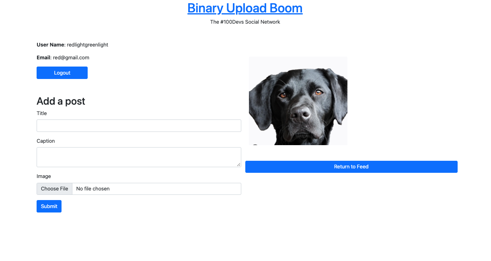

# ☀️ Fullstack Not-Insta App
Use this social media app if you want to connect with friends, and see your custom feed!

# Link
Coming Soon!

# 📋 How to use
Download files.   
Make a new post.   
Let other users upvote or downvote your message!

# 📷 Images

# ✨ Features
Fully responsive design for desktop and mobile.         

# 🔨 Built With
HTML5 – structure,    
CSS3 – responsive design and background,    
JavaScript - frontend and backend.   
Node - backend.   

# 🧠 What I Learned
How to work with Node.    
How to work with APIs.   
How to use fetch().   
How to work with JSON data.  
How to manipulate the DOM.  
How to handle errors.  
